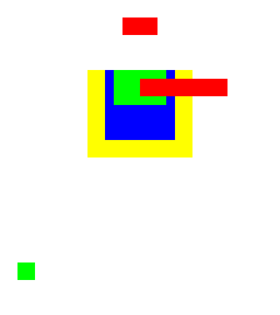
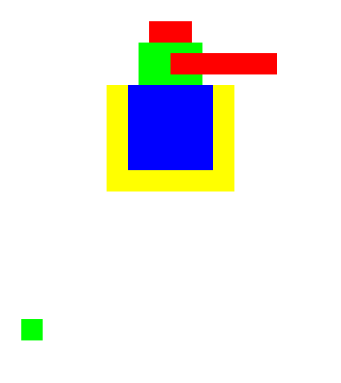
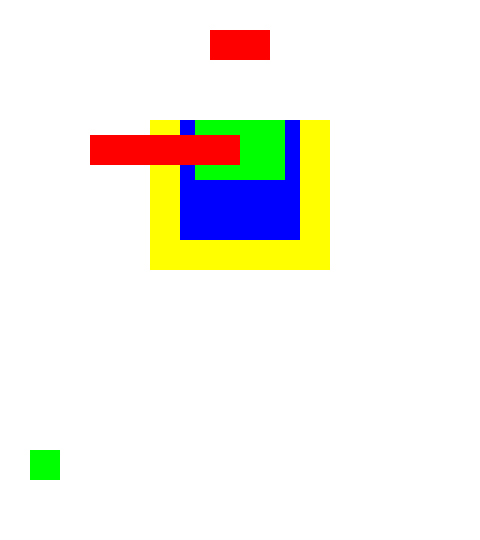

# Mesh import from glTF 2.0, a prototype (issue #244)

Status: **prototype for one decision of [ADR 0003](adr/0003-3d-conversion.md)**,
which was accepted on 2026-10-18. It was run on one synthetic model that a test builds, and
on a file `export_gltf` wrote. **No file of another program was read, no
glTF validator was run, and no 3D program rendered the model for
comparison.**

MCP tool `mesh_import_gltf`, Session operation `mesh.import_gltf`. It reads
the meshes of a glTF 2.0 or VRM file as Parts seen from the front. This is
"a projected mesh", the second of the two ways ADR 0003 leaves open. The
other is "rendered layers".

## What it does

- **One Part for each triangle primitive** that has positions, texture
  coordinates and a base colour texture, on every node that shows the mesh.
  `scenes` is not read. The Part is added below the document root, and its
  vertices are moved to where the DepthRigRoot `root` puts its bones. The
  root may be moved, scaled and turned in the picture plane. A root that is
  moved or turned out of that plane refuses the call. A root that is moved
  after the import does not take the Parts along.
- **Front view.** x and y of a vertex are kept, with the axes of
  [3d-conversion-conventions.md](3d-conversion-conventions.md), and lengths
  are multiplied by `unitsPerSourceUnit`. z is stored as the depth of the
  vertex.
- **Back faces.** A triangle that turns away from the viewer or stands on
  edge is not drawn. A material with `doubleSided` keeps its triangles that
  turn away. A node that mirrors its mesh turns the rule round, as glTF says.
  The report states the count for each Part.
- **Draw order.** The triangles of a Part are sorted far to near, and a
  nearer Part gets a smaller `zsort`, so the renderer draws it later.
- **Texture.** The base colour image is added to the document once and
  shared. The texture coordinates are kept. The sampler is not read: a Part
  draws nothing outside its texture, where the file repeats or clamps it, and
  a primitive with such coordinates is listed (`approximated`). A texture
  reference with an extension, which is how `KHR_texture_transform` moves the
  coordinates, drops its primitive (`dropped`, listed). The base colour
  factor becomes the tint, encoded with the sRGB transfer function. Its alpha
  becomes the opacity for the alpha modes `BLEND` and `MASK` only. The alpha
  of the texture is drawn as blending in every alpha mode, and no cutoff is
  applied.
- **Skin.** A skinned mesh is bound to the DepthRigRoot `root` with one
  weight row for each standard bone that moves a vertex. `rig_import_gltf`
  must have added the bones from the same file with the same
  `unitsPerSourceUnit`. The call is refused when the rest head a standard
  bone stores is not where the file and that scale put it. A bone that was
  changed with `node_transform` keeps its stored rest head and is not seen.
  The weight on a joint that is no standard bone goes to the standard bone
  above it, and the weight on a joint without one is left out (both
  `approximated`). A mesh with a vertex that no bone moves is imported
  unbound (`dropped`, listed).
- **Bind pose.** A skinned vertex is placed by the node of the first joint of
  its skin and the inverse bind matrix of that joint. glTF blends this over
  the joints of a vertex. At the bind pose every joint gives the same place.
  A skin whose joints differ is listed as `approximated`. A mesh without a
  skin is placed by its own node.
- **Depth units.** The rig scales a stored depth by a size it takes from
  everything it binds. The import divides z by that size after it has bound
  the new Parts, and answers it as `depthScale`. Binding another target later
  changes that size and with it the depth of every bound vertex.

The arguments, the `needs` protocol and the loss report are those of
`rig_import_gltf` ([3d-rig-import.md](3d-rig-import.md)). An applied answer
also holds `parts` and `depthScale`, and the resource
`resource://soul2d/mesh/import-report` returns it. One undo step removes the
Parts, the bindings and the textures. A file without a primitive to import
changes nothing and answers `applied: false` with the report.

## What it reads, and what it refuses

- **Inside the file only.** A buffer is the binary chunk of a `.glb` or a
  base64 `data:` URI. An image is a buffer view or a `data:` URI. A relative
  path or any other URI is not read: such a buffer refuses the file, and such
  an image drops its primitives (`dropped`, listed). ADR 0003 has a rule for
  relative paths that this prototype does not implement.
- **PNG only.** A primitive whose image is not a PNG, or does not decode
  within the limits of a stored texture (`render.rs`), is `dropped` and
  listed.
- **Bounds.** The file is at most 64 MiB and its JSON 16 MiB. Every buffer
  view that is read lies inside its buffer and every accessor element that is
  read inside its view. An index names an existing vertex. Every number read
  is finite. A file that breaks one of these is refused and nothing is
  imported. A buffer view or accessor that nothing reads is not checked.
  Every buffer, every node transform and the skin of every mesh node are
  checked, also when no Part comes of them. A file without the humanoid the
  rig import reads is refused.
- **Limits.** A primitive with more than 65,535 vertices is `dropped` and
  listed. A file is refused when it has more than 256 primitives on its mesh
  nodes, or when the primitives that are read hold more than 262,140
  vertices or 262,144 triangles together, or when the images that are read
  hold more than 64 MiB or state more than 134,217,728 pixels, eight times
  the largest texture. A PNG whose header states no pixel or more than a
  texture holds is not decoded and drops its primitives. A primitive counts
  each time a node shows it. A primitive with more than 64 attributes refuses
  the file, and so do sparse accessors and a base colour factor with a number
  of more than 32 characters. A name of the file is cut to 48 characters for
  a mesh and 64 for anything else.
- **Rights.** When the file states rights, the document must already keep
  them, which `rig_import_gltf` does, and the call needs
  `acknowledgeRights`.
- **Not read.** Morph targets, normals and further attribute sets are
  `dropped` and listed, the morph targets of a primitive as one item that
  counts for each of them. Shading is dropped and the material is listed as
  `approximated`. Expressions, physics, extra bones and metadata are not
  touched by this tool. The rig import reports them.

## Measured on the synthetic model

`rust/tests/gltf_mesh.rs` builds the model. It is a humanoid of 19 standard
bones and a hair bone, with these meshes, in canvas units at 100 units a
metre:

| Mesh | What it is | Why it is there |
| --- | --- | --- |
| `Body.0` | A closed box, 40 by 40 and 20 deep, blue | Back faces |
| `Body.1` | A red sleeve at depth 20 over a green chest plate at depth 12, the sleeve first in the file | Order inside one Part |
| `Cape` | A yellow sheet at depth -20 that faces away, double sided | Order between Parts, double sided |
| `Fringe` | A red strip on the hair bone | A joint that is no standard bone |
| `Badge` | A green square without a skin, on a node that mirrors it | Placement by a node, the rule for a mirror |
| `Back`, `Lines`, `Bare` | A one-sided sheet that faces away, a line list, a mesh without a material | What is dropped |

The skinned positions are stored in centimetres and the inverse bind matrices
scale them, so a reader that ignores the bind matrices places them wrongly.

Results. The test asserts every count of a picture the prototype drew. The
count for a 3D view of the half turn is a calculation by hand and no test:

- **Parts.** 5 Parts from 8 primitives. The box shows 2 of its 12 triangles.
  The report counts 4 `converted`, 8 `approximated` and 6 `dropped`.
- **Depth.** `depthScale` is 11.586207, which is 80 units of bound extent
  times 0.42 / 2.9. A quarter turn of the chest bone about its own axis moves
  both sides of the chest plate, from x -15 and x 15, to x 10. That is the 10
  units of depth between the plate and the bone. The fringe behaves the same
  way with its 8 units.
- **Picture at rest.** The renderer draws the picture below. Counted by
  colour it has 700 red, 550 green, 950 blue and 1300 yellow pixels. These
  are the areas a view from the front has to show, worked out by hand from the
  rectangles: the sleeve covers the plate, both cover the box, and the box
  covers the cape.
- **A pose in the picture plane.** The chest bone moved 20 units along itself
  gives 700, 550, 1600 and 1400, which again is the hand count.
- **Half a turn about Y.** The picture has 700, 550, 950 and 1300 pixels
  again, because it is the mirror of the rest picture. A 3D view would have
  0, 100, 0 and 3000 by hand count, when every bone below the pelvis turns
  and a face with one side is not drawn from behind: the cape in front of the
  box, and the badge, which no bone moves. **The projected mesh is wrong
  here**, and no setting of the prototype corrects it.
- **A rig root that is moved and scaled.** With the DepthRigRoot moved by
  (30, 40) and scaled by 2 and the document root moved by (10, 20) before the
  import, the picture at two canvas units a pixel has the rest counts, and
  the chest pose gives its counts again. A root turned a quarter in the
  picture plane gives the rest counts in the turned picture.
- **Save and open.** The posed document was saved as INX and opened in a new
  session. The picture has the same four counts.
- **Read back.** The model was written with `export_gltf` and imported into a
  second document. The picture has the same four counts.

| At rest | Chest bone 20 units up | Half a turn about Y |
| --- | --- | --- |
|  |  |  |

The pictures are 160 by 180 canvas units, three pixels a unit. To write them
again:

```sh
SOUL2D_PROTOTYPE_RENDERS="$PWD/doc/3d-mesh-import-prototype" \
  cargo test --offline --manifest-path rust/Cargo.toml --target-dir out/rust --test gltf_mesh
```

## A projected mesh against rendered layers

Only the left column was built. The right column is reasoning from the
design, not a measurement.

| Question | A projected mesh (this prototype) | Rendered layers (not built) |
| --- | --- | --- |
| What a Part holds | The mesh, its texture coordinates and the texture of the file | A picture of one mesh or material group, drawn from the front |
| New code or dependency | A reader for buffers and accessors, no dependency | A 3D rasteriser with the shading of the file, in the tree or through Blender |
| Shading (MToon, lighting) | Dropped. The Part shows the base colour | Baked into the picture |
| Skin weights | Kept for each vertex | Lost, unless the picture gets a mesh and the weights are projected onto it |
| Depth | The z of each vertex | A depth buffer, sampled where the Part mesh has vertices |
| Surfaces hidden at rest | Front faces behind another surface stay in the mesh. Back faces are gone | A layer drawn alone keeps what other layers hide. Back faces are gone |
| A turn of the model | Right while the front faces stay in front. Wrong past that: the half turn above | Wrong in the same way: a picture has no back |
| Draw order under a pose | Fixed at import, inside a Part and between Parts | Fixed at import, between layers |
| Texture editing | The atlas of the file | A new picture at screen size for each layer |

## What the prototype does not answer

- **Real files.** No model of another exporter was read. Whether real VRM
  files keep their skins within the standard bones, and how many Parts they
  give, is not known.
- **The look.** Without shading a toon model is flat colour. No comparison
  with a 3D view of a real model was made.
- **Performance.** No file of realistic size was imported. Synthetic files
  at the limits were timed with an unoptimised build on one machine. Each
  vertex is on one of the 19 bones, so every Part has 19 weight rows.
  - 62 KB that show a mesh of 1,023 vertices on 256 nodes, onto a rig that no
    parameter poses: 6 seconds for a dry run and 8 seconds for the import.
    The process holds 1.2 GiB at its peak, for about 7 million stored
    numbers. `render` then refuses the document, which is over the limit of
    work of the renderer. One pose key set on that document takes 5 seconds.
  - The same file onto a rig that one parameter with three keys poses: 11
    seconds, and two `deform.continue` calls of 5 and 4 seconds.
  - 584 KB that show a mesh of 12,482 vertices on 21 nodes, onto the posed
    rig: 9 seconds, and two `deform.continue` calls of 5 and 4 seconds.
  - Before the refresh of a rig wrote the bound targets of one key together
    (issue #343), the pose key took 183 seconds and the import onto the
    posed rig 189 seconds and two further calls of 213 seconds each.
- **Turning.** Whether a second view (from the back) imported as further
  Parts would serve a turn is not tried.
- **Mesh editing.** A bound Part refuses a mesh edit that renumbers its
  vertices, and automesh. An imported mesh can be moved, not re-cut.
